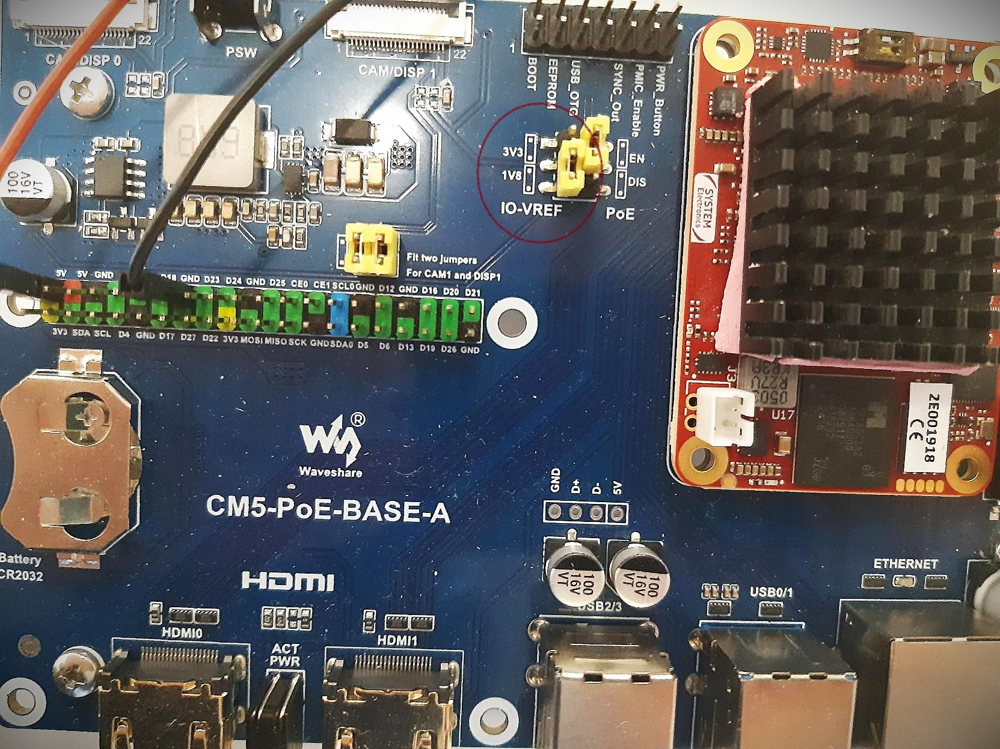
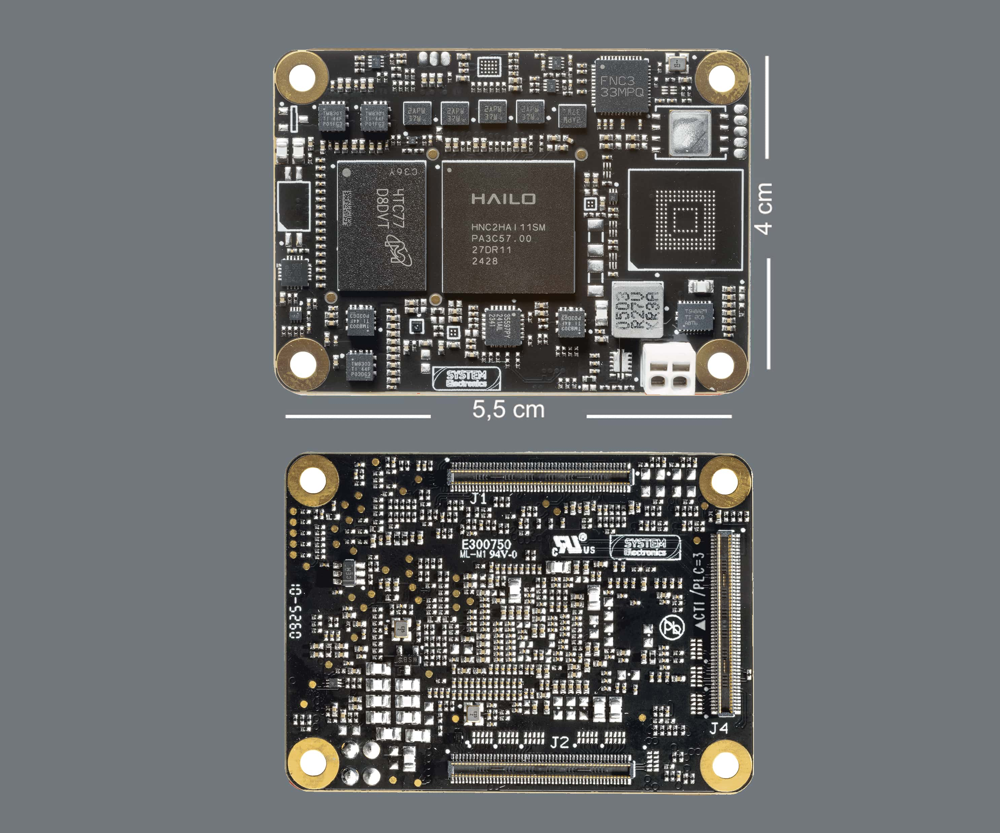
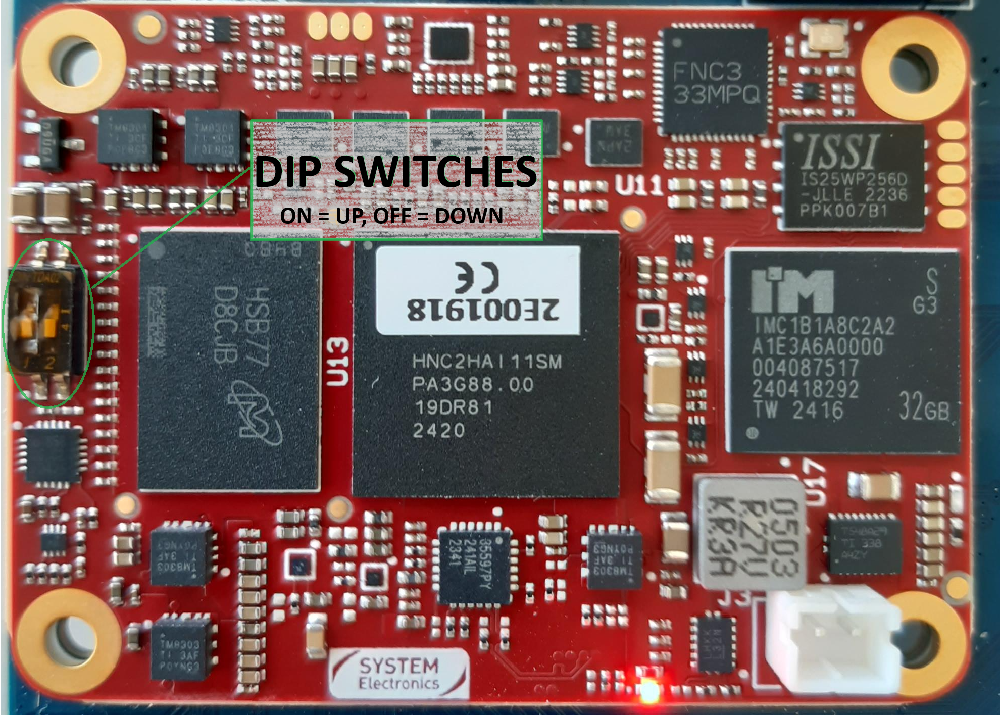
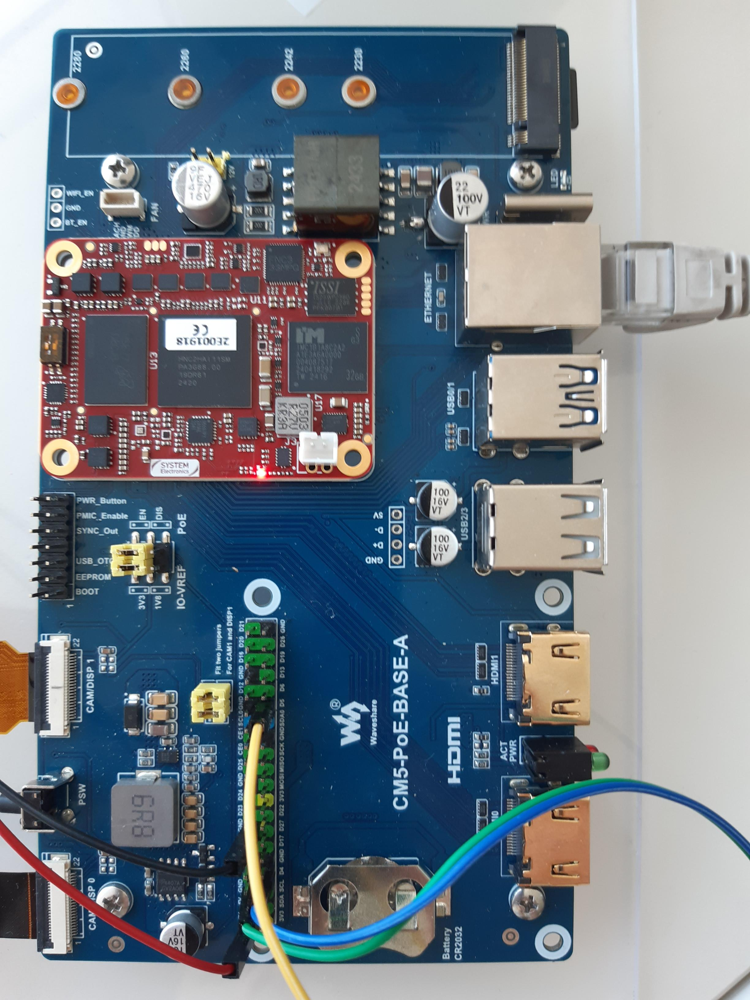

# Astrial H15 Board User Guide

## System Electronics Hailo-15 Development Platform

---

## About this layer

`meta-sysele-bsp` is the System Electronics BSP layer for the **Astrial H15** System on Module. 
It sits on top of Hailo's layers and adds the Astrial machine, its device trees, the
U-Boot and kernel integration, the on-board tools in `/opt/sysele` and the example applications.

### Maintainer

System Electronics. Send patches as pull requests against the default branch, or by
email to Riccardo Fiocchi <hwele05@systemelectronics.com>. Every patch is reviewed before it is merged.

### Dependencies

| Layer | Provides what we append to |
|---|---|
| `core` (poky, `yocto-4.0.35`) | the base |
| `meta-hailo-bsp` | `linux-yocto-hailo`, `hailo-secureboot-assets`, `core-image-hailo-dev` |
| `meta-hailo-media-library` | `libmedialib`, `libgstmedialib`, `expected` |

Yocto release: **kirkstone**. Declared in `conf/layer.conf` through `LAYERSERIES_COMPAT` and
`LAYERDEPENDS`, so a build without those layers fails instead of silently ignoring our bbappends.

The Hailo side comes from the **Hailo Vision Processor Software Package 1.12.0**, which also pins
`meta-hailo` at `kirkstone_v5.3.0` and the kernel at 5.15.32.

### What is in here

| Directory | Contents |
|---|---|
| `conf/machine/` | the `astrial-h15` machine definition |
| `conf/layer.conf` | collection name, dependencies, Yocto compatibility, layer version |
| `kas/` | build configuration: machine, VPU base, cache, poky and meta-hailo pins |
| `recipes-bsp/u-boot/` | U-Boot board support and device tree, including the DDR configuration |
| `recipes-kernel/linux/` | kernel device tree and the patches applied on top of `linux-yocto-hailo` |
| `recipes-sysele/` | `sysele-tools` (the `/opt/sysele` toolbox) and the DSI example applications |
| `recipes-media-library/`, `recipes-gstreamer/` | camera and video pipeline integration |
| `recipes-core/`, `recipes-media-library/` | image and hostname customisations |
| `scripts/` | host-side flashing and TFTP helpers |
| `wic/` | SD card image layout |
| `docs/images/` | pictures used by this README |

### Branches and versions

Branches are named after the Yocto release they target, as is usual for BSP layers: the name of a
branch says which world it builds for, and stays true for as long as the branch lives.

The live line is `kirkstone`. When it moves on, to a newer Hailo stack or a newer Yocto release, the
line left behind stays as a maintenance branch named after what it carries, for example
`kirkstone-vpu-1.12`.

Releases are tagged `vMAJOR.MINOR.PATCH`:

- **major** is the platform line: kirkstone is 1, scarthgap will be 2. Moving Yocto release breaks
  compatibility for anyone building on top, so it is a major.
- **minor** is a substantial change on our side, which in practice means picking up a new Hailo
  Vision Processor package.
- **patch** is everything else.

A release candidate is `v1.2.0-rc1` and is published as a prerelease.

Automatic builds do **not** create tags. A push to the live branch rewrites a single `continuous`
prerelease, so there is always one stable link to the latest build and no tags pile up. A real
release is created by pushing a `v*` tag by hand.

The version that a board reports is the same tag: `sysele-info` prints it on the `BSP` line, and it
is the first thing to ask for in a support request.

### Licence

MIT, granted by System Electronics BU System Ceramics S.p.a. See `LICENSE`.


## QUICKSTART

### What You Need
- Astrial H15 board + compatible CM4/CM5 carrier board
- Ubuntu 20.04+ host computer 
- FTDI USB-to-serial cable
- Ethernet cable
- Internet connection

### Step 1: Download Release Package

Go to [releases page](https://github.com/System-Electronics-Org/meta-sysele-astrial-h15/releases) and download the latest `astrial-h15-yocto-build-<version>.tar.gz` file.

**The archive has no top-level directory**: it unpacks into whatever directory you are in. Give it
one of its own, and keep one directory per release, so you can tell two of them apart later and go
back to an older one without downloading it again:

```bash
mkdir -p ~/astrial/flashing/<version>/release
cd ~/astrial/flashing/<version>
tar -xzf ~/Downloads/astrial-h15-yocto-build-<version>.tar.gz -C release
```

That leaves you with:

```
~/astrial/flashing/
  hailo15_env/                                  the virtual environment from Step 2, shared
  <version>/
    astrial-h15-yocto-build-<version>.tar.gz
    release/
      program_spi_flash.sh                      run the scripts from here
      hailo15_spi_flash_program
      uart_boot_fw_loader
      tftp_server.py
      meta-hailo-soc/build/tmp/deploy/images/astrial-h15/   the images and binaries
```

The scripts find the images through a path relative to themselves, so **run them from inside
`release/`**. From one directory up they will not find anything.

**✓ The tar.gz contains the bootloader, the OS image and all the scripts.**

**One prerequisite is not in it:** the scripts drive the board through Hailo's
`hailo15_board_tools` Python package, which Hailo distributes through the Developer Zone and
we do not redistribute. Step 2 below installs it. Without it `program_spi_flash.sh` stops
before touching the board and tells you so.

### Step 2: Setup Tools and Environment

**Download Hailo board tools:**
Go to [Hailo Developer Zone](https://hailo.ai/developer-zone/software-downloads/) and download the Hailo **Vision Processor** Software Package for Hailo-15H. Extract it and copy the
`hailo15_board_tools-1.12.0-py3-none-any.whl` file to your release folder.

Take it from the Vision Processor package, not from the Accelerators section: Hailo-10 is a
different device family and ships different board tools. Whatever you download is the right
one if it contains a `hailo15_board_tools-*.whl`.

The version must match the Hailo stack of the release you downloaded, and that changes from one
release to the next. **Check the release notes**: every release lists its stack, the Hailo Vision
Processor package among them, and that is the version of the wheel to take.
`program_spi_flash.sh` warns if the installed one differs, but it cannot fetch the right one for you.

Create it **next to** the release directories, not inside one: it is the same for every release and
you want it to survive when you delete an old one.

```bash
cd ~/astrial/flashing
python3 -m venv hailo15_env
source hailo15_env/bin/activate
pip install /path/to/hailo15_board_tools-1.12.0-py3-none-any.whl tftpy
sudo apt-get install u-boot-tools
```

Activate it again in every new shell before running any of the scripts:

```bash
source ~/astrial/flashing/hailo15_env/bin/activate
```

The scripts invoke the Hailo tools through `sudo $(which python3)`, so without the environment active
they pick the system Python and fail to find the package.

Configure USB permissions:
```bash
sudo tee /etc/udev/rules.d/11-ftdi.rules > /dev/null << EOF
SUBSYSTEM=="usb", ATTR{idVendor}=="0403", ATTR{idProduct}=="6011", GROUP="plugdev", MODE="0664"
EOF
sudo udevadm control --reload-rules
```

### Step 3: Set Up the Hardware

Do all of this with the board **unpowered**. Nothing here needs it on, and the DIP switches are read
at power-on.

1. Mount the Astrial H15 SoM on your carrier board.
2. Connect the FTDI cable to the **40-pin header (40PH)**: GND to pin 6, TX to pin 29, RX to pin 7.
3. Set the carrier board's GPIO voltage to **1.8V**.
4. Set the DIP switches to programming mode: **switch 1 ON, switch 2 OFF**.



No Ethernet cable yet. It is not needed to flash the bootloader, and on a PoE carrier plugging it in
powers the board up, which is the opposite of what this step needs.

### Step 4: Flash the Bootloader

Power the board now, either from the carrier's own supply or over PoE. Then:

```bash
./program_spi_flash.sh
```

Run it from the directory where you extracted the release, with the virtual environment from Step 2
active. It takes about five minutes and ends with `SPI Flash Programming Completed Successfully`.

This writes the whole SPI-NOR set: SCU bootloader and firmware, U-Boot and its device tree, TF-A and
the customer certificate. They are a matched set and are always written together.

When it finishes, **power the board down** and set the DIP switches back to normal boot:
**switch 1 OFF, switch 2 OFF**.

### Step 5: Choose How to Write the System

The bootloader is in place, but the board has no operating system yet. There are two ways to put one
there, and a third for later updates. Pick one now and prepare it with the board still off.

| Route | What you need | Writes to |
|---|---|---|
| **TFTP** | an Ethernet cable and a TFTP server on your host | eMMC or microSD, blank or not |
| **SD card** | a card reader on your host | microSD |
| SWU | a board that already runs | updates, not first installation |

TFTP is the one to prefer if you have the cable: it needs no card reader, it writes to a blank eMMC,
and it puts the image where the board boots from in production.

**If you chose TFTP**, connect the Ethernet cable between host and board now, set your host to the
static address `10.0.0.2`, and start the server. The board uses `10.0.0.1`. Full instructions are in
[Setting Up TFTP Server](#setting-up-tftp-server).

> On a PoE carrier the Ethernet cable also carries power. Either power the board from PoE alone, or
> disable PoE on the carrier and keep using its own supply. Do not leave both: decide which one feeds
> the board before plugging the cable in.

**If you chose the SD card**, write it now, from the release you extracted in Step 1:

```bash
sudo dd if=meta-hailo-soc/build/tmp/deploy/images/astrial-h15/core-image-hailo-dev-astrial-h15.wic \
        of=/dev/sdX bs=4M status=progress
sync
```

Replace `/dev/sdX` with your card reader's device, and check it twice: `dd` writes wherever you point
it. Then insert the card in the carrier.

**SWU** is for updating a board that already boots. The `.swu` file in the release is for that, not
for a first installation.

### Step 6: Power On and Install

Open the serial terminal first, so you see the board from the start:

```bash
sudo picocom --baud 115200 /dev/ttyUSB0
```

Power the board on. U-Boot shows its boot menu.

**If you chose TFTP**, pick the entry that matches where you want the system:

- `Update eMMC (wic) from TFTP`
- `Update SDCARD (wic) from TFTP`

The board downloads the image into RAM and writes it from the first block, so the target does not
need to be formatted or even written before. It takes a few minutes, and the menu comes back when it
is done. Then boot it: `Boot from eMMC` or `Boot from SD Card`.

**If you wrote an SD card**, pick `Boot from SD Card`.

Either way you end at the login prompt:

```
root@astrialh15:~#
```

**Login: root, password root.**

### Step 7: Verify Everything Works

```bash
# Check Hailo driver
lsmod | grep hailo

# Test Hailo hardware
hailortcli scan

# Test Python/AI tools
python3 -c "import hailort; print('PyHailort OK')"

# Test network
ping 8.8.8.8
```

**🎉 Success! Your Astrial H15 is now ready for AI development.**

---

## Table of Contents

1. [Introduction](#introduction)
2. [Hardware Overview](#hardware-overview)
3. [Prerequisites](#prerequisites)
4. [Development Environment Setup](#development-environment-setup)
5. [Board Configuration](#board-configuration)
6. [Initial Board Programming](#initial-board-programming)
7. [Operating System Installation](#operating-system-installation)
8. [First Boot and Validation](#first-boot-and-validation)
9. [Troubleshooting](#troubleshooting)
10. [Support](#support)

---

## Introduction

The **Astrial H15** is a professional development board based on the Hailo-15 AI processor, customized by System Electronics for advanced edge AI applications. This guide provides step-by-step instructions to get your board operational from initial unboxing to running your first AI workloads.

### Key Features
- **Up to 20 TOPS AI processing** with Hailo-15 Vision Processor
- **Advanced camera capabilities** with integrated ISP supporting HDR, auto-focus, noise reduction
- **High-speed connectivity** including Gigabit Ethernet, USB 3.0, PCIe Gen3
- **Professional interfaces** with MIPI CSI/DSI for cameras and displays
- **Secure architecture** with hardware cryptography and secure boot
- **Yocto Linux-based OS** with Python 3.10 and AI development tools
- **Real-time, low-latency inference** optimized for edge computing
- **CM5 System on Module** form factor for industrial applications

---

## Hardware Overview

### Board Layout



### Key Components

1. **Hailo-15 Vision Processor** - Up to 20 TOPS AI processing power
2. **eMMC Storage** - 32GB onboard storage for applications and data
3. **Integrated Image Signal Processor (ISP)** - Advanced camera processing capabilities
4. **Gigabit Ethernet** - High-speed network connectivity
5. **MIPI CSI & DSI** - Camera and display interfaces
6. **USB 3.0 & PCIe Gen3** - High-bandwidth peripheral connectivity

### DIP Switch Configuration

The board features configuration DIP switches for different boot modes:



| Mode | Switch 1 | Switch 2 | Description |
|------|----------|----------|-------------|
| Normal Boot | OFF | OFF | Standard eMMC boot |
| SPI Programming | ON | OFF | Enable SPI flash programming |
| Recovery Mode | ON | ON | UART recovery mode |

---

## Prerequisites

### Hardware Requirements

- Host computer running Ubuntu 20.04 LTS or newer
- Minimum 8GB RAM, 100GB free disk space
- USB ports for serial connection
- Ethernet port or adapter
- Internet connection for package downloads

### Software Requirements

- Python 3.8 or newer
- Git version control system
- Build tools (will be installed during setup)

---

## Development Environment Setup

### Installing Hailo-15 Board Tools

1. **Download Hailo Software Package**

Download the Hailo Vision Processor Software Package from:
[https://hailo.ai/developer-zone/software-downloads/](https://hailo.ai/developer-zone/software-downloads/)

2. **Extract the Software Package**

```bash
tar -xzf hailo_vision_processor_sw_package_<version>.tar.gz
cd hailo_vision_processor_sw_package_<version>/tools
```

3. **Create Python Virtual Environment**

```bash
python3 -m virtualenv hailo15_env
source hailo15_env/bin/activate
```

4. **Install Board Tools**

```bash
pip install hailo15_board_tools-<VERSION>.whl
sudo apt-get install u-boot-tools
```

5. **Configure USB Device Rules**

```bash
sudo vim /etc/udev/rules.d/11-ftdi.rules
```

Add the following line:
```
# FT4232/FT4232H 
SUBSYSTEM=="usb", ATTR{idVendor}=="0403", ATTR{idProduct}=="6011", GROUP="plugdev", MODE="0664"
```

### Option 1: Using Prebuilt Images (Quick Start)

For rapid deployment without building from source, you can use the prebuilt images from the releases page of this repository:

**Download Prebuilt Images:**

Go to the [releases page](https://github.com/System-Electronics-Org/meta-sysele-astrial-h15/releases) and download the latest release artifact. The artifact is a zip file containing all the necessary files, including the `.wic` images.

**Available Images:**
- `core-image-hailo-dev-astrial-h15.wic` - Complete development image with AI tools

**Skip to [Operating System Installation](#operating-system-installation) if using prebuilt images.**

---

### Option 2: Building from Source

### Setting Up Yocto Build Environment with KAS

1. **Install KAS Build Tool**

```bash
pip3 install "kas==5.3"
```

2. **Clone Main Hailo Repository**

```bash
git clone --branch 1.12.0 --single-branch https://github.com/hailo-ai/meta-hailo-soc.git
cd meta-hailo-soc
```

3. **Clone System Electronics Customization Layer**

```bash
git clone https://github.com/System-Electronics-Org/meta-sysele-astrial-h15.git meta-sysele-bsp
```

4. **Secure Boot Configuration**

The Yocto build requires cryptographic keys for secure boot functionality. Create the customer keypair file:

```bash
# Navigate to the meta layer
cd meta-sysele-bsp
```

**Note**: The `customer_keypair.pem` file is intentionally not included in the repository for security reasons. 

For detailed instructions on generating and configuring secure boot keys, please refer to the **Hailo OS Secure Boot User Guide (hailo_os_secure_boot_user_guide.pdf)** available in the [Hailo Developer Zone](https://hailo.ai/developer-zone/software-downloads/).

**Warning**: Never commit private keys to version control. Keep your cryptographic keys secure and separate from your source code.

5. **Build Using KAS**

```bash
kas build meta-sysele-bsp/kas/astrial-h15.yml
```

This single command will:
- Initialize all required repositories and submodules
- Configure the build environment for Astrial H15
- Set up all necessary layers and dependencies
- Build the complete development image

### Alternative: Manual Build Environment Setup

If you prefer to set up the environment manually without KAS:

1. **Initialize Submodules**

```bash
git submodule update --init --recursive
```

2. **Initialize Build Environment**

```bash
source oe-init-build-env build-astrial-h15
```

3. **Configure Build Settings**

Edit `conf/local.conf`:
```bash
MACHINE = "astrial-h15"
DISTRO = "hailo-distro"
```

---

## Board Configuration

**Important**: The Astrial H15 is a System on Module (SoM) that requires a compatible carrier board. This guide uses the **Waveshare CM5 PoE Base-A** as reference, but the Astrial H15 is compatible with any CM4 or CM5 carrier board.

**Carrier Board Compatibility:**
- CM4 compatible carriers
- CM5 compatible carriers  
- Reference carrier: [Waveshare CM5 PoE Base-A](https://www.waveshare.com/cm5-poe-base-a.htm)

### Physical Setup

1. **Mount SoM on Carrier Board**



Mount the Astrial H15 SoM onto your carrier board following the carrier manufacturer's installation guide.

2. **Connect Serial Debug Cable (FTDI)**


Connect an FTDI USB-to-serial adapter with the following pin connections:

**FTDI to Carrier Board GPIO:**
- **GND (Black)** → **Pin 6** (Ground)
- **TX (Orange)** → **Pin 29** (GPIO5 - UART RX)  
- **RX (Yellow)** → **Pin 7** (GPIO4 - UART TX)

**Note**: Refer to your specific carrier board documentation for GPIO pinout confirmation. The pin numbers reference the standard 40-pin GPIO header layout.

**⚠️ Important GPIO Voltage Settings:**
- **MIPI/CSI Display**: When connecting displays to MIPI/CSI interfaces, the carrier board's **GPIO voltage must be set to 3.3V**

3. **Network Connection**

Connect an Ethernet cable between your host computer and the Ethernet port on your carrier board.

**For Waveshare CM5 PoE Base-A**: Use the onboard Gigabit Ethernet port or PoE functionality.

4. **Power Connection**

Connect power to your carrier board according to the carrier manufacturer's specifications.

**For Waveshare CM5 PoE Base-A**: Use either the DC power input or PoE power delivery.

### DIP Switch Configuration for Programming

Before initial programming, configure the DIP switches for SPI programming mode:


- Switch 1: **ON**
- Switch 2: **OFF**

---

## Initial Board Programming

### Programming the SPI Flash

1. **Build the Yocto Image**

Using KAS (recommended):
```bash
kas build meta-sysele-bsp/kas/astrial-h15.yml
```

Or using manual bitbake:
```bash
bitbake core-image-hailo-dev
```

2. **Execute SPI Flash Programming**

The meta layer includes a pre-configured script for SPI flash programming. From your meta layer directory:

**Note**: If using prebuilt images, copy and unzip the file directly in the script folder

```bash
cp astrial-h15-yocto-build-<version>.tar.gz meta-sysele-bsp/scripts/
cd meta-sysele-bsp/scripts/
tar -xzf astrial-h15-yocto-build-<version>.tar.gz
```

```bash
./scripts/program_spi_flash.sh
```

**Note**: this script will search the bootloader and all the other build files in the same folder or in a possible yocto build folder

**Optional**: If your serial device is not `/dev/ttyUSB0`, specify it as an argument:


```bash
./program_spi_flash.sh /dev/ttyUSB1
```


The script will automatically:
- Verify build artifacts are available
- Check serial device connectivity  
- Load UART boot firmware
- Program all required components to SPI flash
- Provide success confirmation and next steps

3. **Restore Normal Boot Configuration**

After successful programming, power down the board and restore DIP switches:


- Switch 1: **OFF**
- Switch 2: **OFF**

---

## Operating System Installation

### Setting Up TFTP Server

1. **Install TFTP Server Tools**

```bash
source hailo15_env/bin/activate
pip install tftpy
```

2. **Start TFTP Server**

#### Option A: Using Prebuilt Images

**Note**: If using prebuilt images, serve directly from the downloaded directory (unzip the release file only if you didn't it already for the "SPI Flash programming"):

```bash
cp astrial-h15-yocto-build-<version>.tar.gz meta-sysele-bsp/scripts/
cd meta-sysele-bsp/scripts/
tar -xzf astrial-h15-yocto-build-<version>.tar.gz
sudo $(which python3) ./tftp_server.py --port 69  .
```

**Note**: Be sure that the folder contains the .wic file from the zip

#### Option B: Using Built Images

The meta layer includes a pre-configured TFTP server script. From your meta layer directory:

```bash
cd meta-sysele-bsp/scripts
sudo $(which python3) ./tftp_server.py --port 69
```

**Note**: Root privileges (sudo) are required for binding to TFTP port 69.

The script will automatically:
- Detect the correct build directory path
- List available .wic files for programming
- Create symlinks for correct TFTP filename matching (`core-image-hailo-dev-astrial-h15.wic`)
- Configure network settings for board communication
- Provide clear status information

**Optional**: If your build directory is in a non-standard location, specify it manually:

```bash
sudo $(which python3) scripts/tftp_server.py --port 69 /custom/path/to/build/tmp/deploy/images/astrial-h15
```

### Programming eMMC Storage

1. **Configure Network Settings**

Set up your host computer with static IP:
- Host IP: `10.0.0.2`
- Board IP: `10.0.0.1` (automatically configured)

2. **Open Serial Terminal**

```bash
sudo picocom --baud 115200 /dev/ttyUSB0
```

**Note**: Root privileges may be required for serial port access depending on your system configuration.

3. **Power On and Access Boot Menu**

Power on the board. You should see the U-Boot boot menu:

The menu lists the ways to boot and the ways to write the storage. The ones that write are:

```
   Update eMMC (wic) from TFTP
   Update SDCARD (wic) from TFTP
```

Move with UP and DOWN, select with ENTER. Read the entry rather than counting positions: the menu
gains and loses entries between releases, so a position is not a stable way to refer to one.

4. **Configure Boot Environment** (Optional)

The board environment is pre-configured with correct values. However, if needed, you can manually set:

```bash
setenv boot_mmc 'run bootargs_base bootargs_mmc && run load_fitimage_from_mmc && bootm ${far_ram_addr}#conf-sysele_${machine_name}.dtb${dtb_overlays}'
setenv machine_name astrial-h15
setenv core_image_name core-image-hailo-dev
setenv board astrial-h15
saveenv
```

**Note**: These values are automatically configured in the meta layer and don't typically require manual setting.

5. **Program eMMC**

**IMPORTANT**: From the U-Boot menu, select **"Update eMMC (wic) from TFTP"**, by name.

The system will:
- Download `core-image-hailo-dev-astrial-h15.wic` via TFTP
- Write the complete image (kernel + rootfs) to eMMC storage
- Return to the boot menu

**Expected TFTP output:**
```
TFTP from server 10.0.0.2; our IP address is 10.0.0.1
Filename 'core-image-hailo-dev-astrial-h15.wic'
Load address: 0x85000000
Loading: ############### (several minutes for ~2GB transfer)
Bytes transferred = 2290767872 (888a5800 hex)
Device: sdio1@78001000
Manufacturer ID: 9e
OEM: 100
Name: IM032 
Bus Speed: 52000000
Mode: MMC High Speed (52MHz)
Rd Block Len: 512
MMC version 5.1
High Capacity: Yes
Capacity: 29.1 GiB
Bus Width: 4-bit
Erase Group Size: 512 KiB
HC WP Group Size: 8 MiB
User Capacity: 29.1 GiB
Boot Capacity: 4 MiB ENH
RPMB Capacity: 4 MiB ENH
Boot area 0 is not write protected
Boot area 1 is not write protected

MMC write: dev # 1, block # 0, count 4474157 ... 
(wait several minutes for eMMC programming to complete)
4474157 blocks written: OK
```

**IMPORTANT TIMING NOTES:**
- **TFTP Download**: Takes several minutes (~2-5 minutes for 2GB+ image transfer)
- **eMMC Programming**: After download completes, wait additional 3-5 minutes for the actual writing to eMMC
- **Do NOT interrupt**: The process may appear frozen during eMMC write - this is normal
- **Total time**: Allow 10-15 minutes total for the complete process

**Note**: If you see `Filename 'fitImage'` instead of the .wic file, you selected the wrong menu option. Use the `bootmenu` command to return to the menu and select "Update eMMC (wic) from TFTP".

---

## First Boot and Validation

### Booting the Operating System

1. **Select eMMC Boot**

From the U-Boot menu, select "Boot from eMMC".

2. **First Boot Process**

The system will boot into the Yocto Linux environment. First boot may take several minutes.

3. **Login**

You should see the prompt: `root@astrialh15:~#`

Default credentials:
- Username: `root`
- Password: `root`

### System Validation

1. **Check System Information**

```bash
uname -a
cat /proc/cpuinfo
```

2. **Verify Hailo Driver**

```bash
lsmod | grep hailo
```

3. **Test Hailo Runtime**

```bash
hailortcli scan
```

4. **Verify Python3 and PyHailort**

```bash
python3 --version
python3 -c "import hailort; print('PyHailort available')"
python3 -c "import numpy; print('NumPy available')"
```

5. **Test Network Connectivity**

```bash
ping 8.8.8.8
```

6. **Check Storage**

```bash
df -h
```

---

## Troubleshooting

### Common Issues

#### Board Not Powering On


- Verify power adapter connection according to your carrier board specifications
- Check power LED indicators on the board
- Ensure your power supply meets the carrier board requirements

#### Serial Connection Issues

- Verify USB-to-serial driver installation
- Check device path (`/dev/ttyUSB0` or similar)
- Ensure correct baud rate (115200)
- **Troubleshooting**: If no serial output appears, try setting the carrier board's GPIO voltage to 1.8V

#### TFTP Transfer Failures

- Verify network connectivity between host and board
- Check firewall settings on host computer
- Ensure TFTP server is running with correct permissions

#### Process Appears Frozen During eMMC Programming

**Symptoms**: After TFTP download completes, the system shows `MMC write: dev # 1, block # 0, count XXXXX ...` and appears to hang.

**This is NORMAL behavior**: 
- The eMMC writing process takes 3-5 minutes and shows no progress indicators
- Do NOT power cycle or interrupt the board during this phase
- Wait patiently for the `blocks written: OK` message
- Total process time: 10-15 minutes from start to finish

#### System Shutdown Issues

**Note**: The `poweroff` command has been configured to properly power down the system. However, if you experience issues:

**Alternative shutdown methods**:
```bash
halt -p     # Force power off
shutdown -h now    # Standard shutdown
```

#### Wrong File Being Downloaded (fitImage instead of .wic)

If you see TFTP downloading `fitImage` instead of `core-image-hailo-dev-astrial-h15.wic`:

**Cause**: You selected the wrong boot menu option (likely "Boot from NFS" or "Autodetect")

**Solution**: 
1. Press Ctrl+C to interrupt the boot process
2. Run `bootmenu` command to return to the boot menu  
3. Select exactly **"Update eMMC (wic) from TFTP"**
4. Verify the TFTP output shows the .wic filename

#### Boot Menu Not Appearing

- Verify SPI flash programming was successful
- Check DIP switch configuration
- Power cycle the board

#### SPL Boot Error (Partition Not Valid)

If you see errors like "Partition 1 not valid" or "SPL: failed to boot from all boot devices", this indicates the boot source configuration needs to be updated.

**Solution**: The meta layer has been configured with the correct boot source (`nor` instead of `mmc2`) and improved autodetect logic. Rebuild and reprogram:

```bash
bitbake core-image-hailo-dev -c cleansstate
bitbake core-image-hailo-dev
./scripts/program_spi_flash.sh
```

#### Automatic Boot Sequence

The board's autodetect feature now follows this logical sequence:
1. **eMMC Boot** - Primary boot source (when programmed)
2. **SD Card Boot** - Automatic fallback when eMMC is empty/invalid
3. **NFS Boot** - Network boot fallback
4. **Error** - If all sources fail

This ensures that boards with empty eMMC will automatically boot from SD card without manual menu selection.

### Getting Help

For technical support:

1. Check the troubleshooting section above
2. Review system logs: `dmesg` and `/var/log/messages`
3. Open an issue on the official GitHub repository with:
   - Board serial number  
   - Detailed error description
   - System logs if applicable

---

## Support

### Technical Support

**System Electronics**
- **GitHub Issues**: [https://github.com/System-Electronics-Org/meta-sysele-astrial-h15/issues](https://github.com/System-Electronics-Org/meta-sysele-astrial-h15/issues)
- **Website**: [https://www.systemelectronics.ai/en](https://www.systemelectronics.ai/en)

### Documentation Updates

This documentation is regularly updated. Check the GitHub repository for the latest version.

### Community Resources

- **Main Repository**: [https://github.com/System-Electronics-Org/meta-sysele-astrial-h15](https://github.com/System-Electronics-Org/meta-sysele-astrial-h15)
- **Prebuilt Images**: [https://github.com/System-Electronics-Org/meta-sysele-astrial-h15/releases](https://github.com/System-Electronics-Org/meta-sysele-astrial-h15/releases)

---

*Copyright © 2025-2026 System Electronics BU System Ceramics S.p.a.*
*System Electronics, a Coesia brand.*
*Released under the MIT License, see [LICENSE](LICENSE).*

*The Hailo software this layer builds against is covered by its own licence terms, which are not
affected by the above.*

